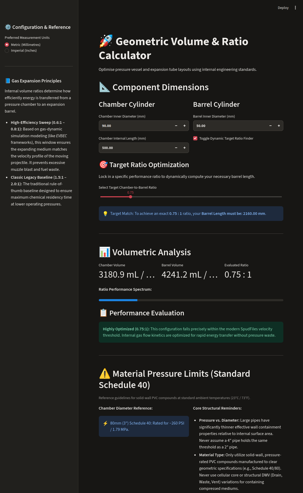

## Potato cannon (spud chucka) chamber to barrel ratio calculator

Gemini's interpretation of a calculator based on data from spudfiles here:
https://spudfiles.com/spud_wiki/index.php?title=Chamber_to_barrel_ratio

It uses python and streamlit for the webapp and docker compose for the build / deployment process. 

- Have I made one of these? No. Not only is it illegal where I live, I am too lazy to construct one. 
- Is the mathematics behind this solid and confirmed? Bitch please! It appears to math.
- Should I use this as the basis for my (legal where I live) potato cannon? That's a solid NO from me, but knock yourself out.  

The calculator looks like this: 




## To build it

```
docker compose up -d --build
docker build -t potato-launcher-calculator:latest .
```

Then get your math on at http://127.0.0.1:8501

```
docker ps 
```

Take it down, bring it up. You can work it out!

```
docker compose down
docker compose up -d 
```

## The science 

None applied by me. I have no idea what I'm doing.

## The math

Nope. If its correct, all credit goes to lords of flying praties over at spudfiles.com. Also the AI for interpreting it correctly, I guess. If it's incorrect, I don't care tbh. 

## The security 

None. It's probably a nightmare. Deploy online at your own risk. 

Thank you for your attention to this matter,
Vivaldi I.T. Hood
